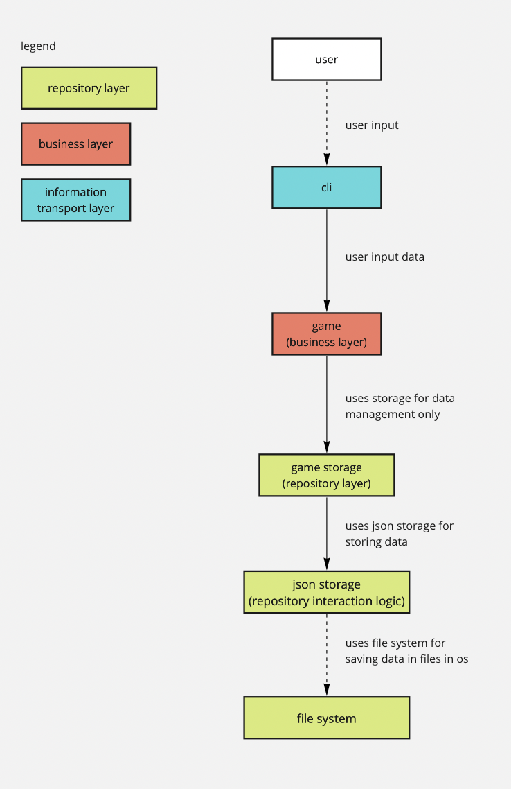

# game-cli

A small turn-based shooter game played from the command line. Players join the game,
shoot each other and heal; a player whose HP reaches 0 is out, and the last one standing wins.

A learning project (2022) about layered architecture in Python: CLI → business logic → storage.

## Requirements

- Python 3.8 or newer
- No third-party packages (standard library only)

## Quick start

```bash
python3 main.py connect --username=Ann --type=Skeleton
python3 main.py connect --username=Bob --type=Base
python3 main.py game --state=Start
python3 main.py shoot --shooter=Ann --target=Bob
python3 main.py heal --username=Bob
python3 main.py game --state=End
```

The game state is saved in `game.json` (created on the first run). Logs go to `log/app.log`.
Delete `game.json` to start over.

## Commands

| Command | Arguments | What it does |
|---|---|---|
| `connect` | `--username`, `--type` (`Base` / `Skeleton`) | Adds a player (only while the game has not started) |
| `disconnect` | `--username` | Removes a player |
| `game` | `--state` (`Start` / `End`) | Starts the game or ends it |
| `shoot` | `--shooter`, `--target` | The shooter deals damage to the target |
| `heal` | `--username` | Restores some HP to the player |

## Player types

| Type | Damage | Heal |
|---|---|---|
| Base | 20 | +20 HP |
| Skeleton | 40 | +10 HP |

Every player starts with 100 HP.

## Project structure

```
main.py        command-line interface (argparse)
app.py         routes commands to use cases
usecase/       game rules: connecting players, starting the game, shooting, healing
player/        player types (abstract player, Base, Skeleton) and a factory
models/        game state and player type enums
storage/       saving players and game state in a JSON file
scripts/       logging practice script
docs/          component diagrams
```



## Ideas for later

- Add a maximum number of players per game (JSON schema, check in the use case)
- Do not allow shooting at a player who is already out
- Add the `Creeper` player type (already listed in `PlayerType`)
- Add unit tests
